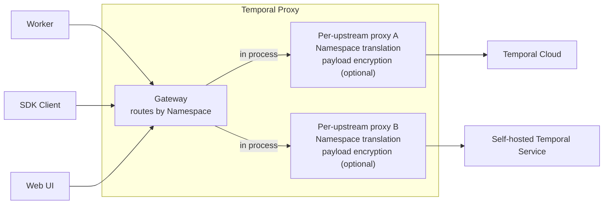

# Temporal Proxy ([Public Preview])

[](https://github.com/temporalio/temporal-proxy/actions/workflows/ci.yaml)
[](https://codecov.io/gh/temporalio/temporal-proxy)
[](https://github.com/temporalio/temporal-proxy/releases)
[](https://docs.temporal.io/production-deployment/temporal-proxy/)
[](https://pkg.go.dev/go.temporal.io/proxy)
[](LICENSE)

> [!NOTE]
>
> **[Public Preview]:** Starting with version 1.0, Temporal Proxy is suitable for production use cases.
> Breaking changes between minor releases are possible but will be kept to a minimum.
> Minor bug fixes are generally applied only to the latest release. Critical fixes and patches will be applied to the
> latest minor release and the two before it (for example, `v1.0`, `v0.10`, and `v0.9`).

A gRPC proxy that sits between Temporal SDK Clients, Workers, and the Temporal UI on one side and one or more upstream
Temporal Services on the other. It handles Namespace translation, TLS termination, and payload encryption so
applications can target a single local endpoint while the proxy fans requests out to the right upstream (a local dev
Temporal Service, a self-hosted deployment, Temporal Cloud, or some mix).

## Why

Connection details leak into application code. Every Worker and Client has to know the upstream's host, TLS material,
credentials, and the exact Namespace name the upstream expects. That couples your code to an environment and makes
moving between a local Temporal Service, a self-hosted deployment, and Temporal Cloud a code change.

The proxy pulls that concern out. Workers talk plaintext to a single local endpoint using a short Namespace name; the
proxy owns TLS, credentials, and Namespace translation on the way out. Point a Worker at a different Namespace and it
reaches a different upstream with no change to the Worker.

## How



## Features

- **Rule-based routing.** Route requests to different upstreams by Namespace and/or request metadata, with a system
  upstream for Namespace-less calls and a default fallback.
- **Service allowlist.** Forward only the gRPC services you name, defaulting to `WorkflowService` and `OperatorService`.
  Server reflection is opt-in, and a service you leave out is never forwarded.
- **Namespace translation.** Rewrite local Namespace names to the names an upstream expects (prefix, suffix, or explicit
  overrides) in both requests and responses.
- **TLS termination and outbound credentials.** Terminate inbound TLS/mTLS and attach the upstream's own TLS and
  credentials (API key or mTLS), so client code carries none of it.
- **SRV discovery.** Set an upstream's `hostPort` to `srv:///<record>` (for example
  `srv:///_grpc._tcp.temporal-frontend.temporal.svc.cluster.local`) and the proxy balances round-robin across every
  backend the record lists. It re-reads the record every 30 seconds, and within 5 seconds of a backend failing.
  `maxConnections` (default 32) applies per backend, so 4 connections across 10 backends opens 40. Over TLS, every
  backend's certificate is verified against the record name minus its leading `_service._proto` labels
  (`temporal-frontend.temporal.svc.cluster.local` above), not the host each record points at; set `tls.serverName` when
  the certificates carry a different name.
- **Payload encryption.** Optionally seal payloads with envelope encryption on the hop to an upstream and open them on
  responses, so the upstream only ever sees ciphertext while local Workers keep exchanging cleartext. DEKs are wrapped
  by a KMS key (AWS KMS, Azure Key Vault, or GCP KMS), rotate automatically, and can be overridden per Namespace.
  Set `encryption.failures` to seal failure messages and stack traces too, as the SDK's `EncodeCommonAttributes` does.
  Payloads can be bound to the Namespace they were sealed in, authenticated as AES-GCM additional data.
  `encryption.namespaceBinding` is required whenever keys are configured: `strict` for a new deployment, `off` for an
  existing one until it follows [Namespace binding](#namespace-binding).

  Payloads a Worker's own codec already encrypted, or that an earlier proxy sealed, can be forwarded as they are by
  listing their encoding under `encryption.skipEncodings`. Listing an encoding trusts every Worker that sets it: the
  proxy cannot tell ciphertext from plaintext labeled that way. Listing `binary/encrypted` also returns responses sealed
  under a KEK this proxy doesn't hold, including its own if a key was removed from config, rather than failing the
  call, so alert on `vault_ops_total{result="unknown_key"}`.
- **Pluggable key management.** For a backend the proxy has no built-in support for, such as an on-prem HSM or an
  internal key service, point it at an extension server you run and it wraps DEKs through that instead. Only key
  material is exchanged; payloads never reach it.
- **Codec server.** Serve the `/encode`, `/decode`, and `/download` routes the Temporal CLI and Web UI use to seal and
  open payloads directly, without a Worker's data converter in the loop. A codec server holds the same KMS unwrap
  permission the proxy itself does, so one that is reachable without authentication is a decryption oracle; see
  [Codec server](#codec-server) for the config and how it is locked down.
- **Runtime profiling.** Serve the standard pprof endpoints on the HTTP listener under `http.pprof:`, off by default.
  Pull a profile with `curl` and read it with `go tool pprof`; see [Profiling](#profiling) for the config.
- **Inbound authentication and authorization.** Optional static-token or JWKS validation on the gateway; off by default.
  For rules neither covers, delegate the decision to an extension server you run. It is told what the call is addressing
  (the gRPC method, and the Namespace the proxy resolved from the request rather than from anything the caller claims),
  so it can decide per Namespace and per method rather than only whether the caller is who it says it is.
- **Prometheus metrics.** Expose request latency and counts, routing decisions, and payload sealing and opening on
  `/metrics`. The listen address and the metric prefix stamped onto every metric name are set under `metrics:` in the
  config, along with the labels every series carries: constants such as the region the proxy runs in, and request
  metadata carried onto the request-scoped series, so they can be sliced by a dimension only your callers know.
- **Codec-transparent.** Payload data passes through untouched unless encryption is configured. The proxy reads only
  the Namespace and the fields it translates, and needs no knowledge of your data converter or codec.
- **Multiple deployment options.** Ship as a Go binary, a container image, or a Helm chart.

## Installation

### Go

Install the `proxy` binary into your `$GOBIN` with `go install`:

```bash
go install go.temporal.io/proxy/cmd/proxy@latest
```

`@latest` resolves to the newest stable release. Pin an explicit version from the
[releases page](https://github.com/temporalio/temporal-proxy/releases) if you prefer:

```bash
go install go.temporal.io/proxy/cmd/proxy@vX.Y.Z
```

### Container image

Images are published to [Docker Hub](https://hub.docker.com/r/temporalio/temporal-proxy):

```bash
docker pull temporalio/temporal-proxy:latest
```

To guard against a deployment that would forward payloads unencrypted, start the proxy with
`--require-encryption` (or set `PROXY_REQUIRE_ENCRYPTION=true`). The proxy then refuses to start unless the config
has an encryption key (`encryption.default`). It checks for a key rather than `encryption.enabled`, so a decrypt-only
proxy (a key with `enabled: false`) still starts. The flag sits outside the config file so that editing the config
alone cannot turn it off.

### Helm

A chart is published to the Temporal Helm repo at `https://go.temporal.io/helm-charts`:

```bash
# Latest stable release
helm install temporal-proxy temporal-proxy \
  --repo https://go.temporal.io/helm-charts

# Or pin a specific proxy version (see the releases page)
helm install temporal-proxy temporal-proxy \
  --repo https://go.temporal.io/helm-charts \
  --set image.tag=vX.Y.Z
```

Each chart release deploys a proxy version by default; `--set image.tag` overrides it to pin a specific one.

Supply the proxy config under the `config:` key in a values file and pass it with `-f`:

```yaml
# values.yaml
config:
  hostPort: :7233
  upstreams:
    - name: local
      hostPort: localhost:7234
      insecure: true
  routing:
    default: local
```

```bash
helm install temporal-proxy temporal-proxy \
  --repo https://go.temporal.io/helm-charts \
  -f values.yaml
```

See the [chart README] for the full set of options.

[chart README]: https://github.com/temporalio/helm-charts/tree/main/charts/temporal-proxy

## Get started

The [Temporal Cloud example](examples/cloud) is the quickest way to see the proxy in action: a Worker and starter that
carry no Cloud configuration talk plaintext to `localhost:7233`, and the proxy adds TLS, the API key, and the Namespace
rewrite on the way to Cloud. Follow its README to run it end to end.

The [KMS extension server example](examples/kms) shows the pluggable key management path end to end: a local dev server,
a key provider you run, and Workflow payloads that the Temporal Service only ever stores as ciphertext. It is built on
[`pkg/ext`](pkg/ext), which supplies the gRPC surface, the credential check, TLS, and graceful shutdown, so writing your
own extension server means implementing the key handling and little else.

The [authorization example](examples/authz) does the same for access control: an extension server maps a JWT to claims
and then decides each call against them, the two steps Temporal OSS splits across its `ClaimMapper` and `Authorizer`.
Four tokens show what that buys, including a Worker that cannot reach a second Namespace and an auditor that can read
history but not start a Workflow.

## Codec server

The proxy can serve the Temporal SDK's codec server HTTP contract, so the Temporal CLI and Web UI can seal and open
payloads directly, without a Worker's data converter in the loop. It answers `POST /encode`, `POST /decode`, and
`POST /download`, each also reachable under a Namespace path segment (`/{namespace}/decode`, and so on) for the CLI's
`--codec-endpoint` templating. An unknown path answers 404; a known one called with anything but `POST` answers 405,
which is a deliberate divergence from the Temporal SDK's own codec handler, whose equivalent case answers 404.

The codec server is a route group on the proxy's HTTP server, which listens on its own port, separate from the
gateway's. The listener is configured under `http:`, and the codec server under `http.codecServer:`. Nothing binds
unless a route group is enabled.

| Key                                 | Default | Meaning                                                                                                     |
| ----------------------------------- | ------- | ----------------------------------------------------------------------------------------------------------- |
| `http.hostPort`                     | none    | Address the HTTP server listens on.                                                                         |
| `http.insecure`                     | `false` | Serve plaintext instead of TLS. Validation only allows this on a loopback bind.                             |
| `http.tls`                          | none    | Certificate and key to terminate TLS with.                                                                  |
| `http.codecServer.enabled`          | `false` | Turns the codec server on.                                                                                  |
| `http.codecServer.cors.origins`     | none    | Origins a browser-based caller, such as the Cloud UI, may reach the codec server from.                      |
| `http.codecServer.cors.credentials` | `false` | Whether a browser may send cookies and `Authorization` alongside an allowed origin.                         |
| `http.codecServer.auth`             | none    | Static-token or JWKS authentication. Required, along with `http.tls`, once `http.hostPort` is not loopback. |

In v0.8.0, these keys all lived in a top-level `codecServer:` block. A config that still has one fails validation
rather than starting with the codec server silently off.

A codec server holds the same KMS unwrap permission the proxy itself does: whoever can reach it can decrypt anything
an operator's keys protect. That is why configuration requires authentication and TLS the moment `http.hostPort` is
not loopback, and why a loopback bind, meant for local development where the caller is on the same host, is left
unauthenticated by default rather than by oversight. Point one at anything but `127.0.0.1` or `localhost` only once
`auth` and `tls` are configured.

`auth` verifies who is calling, not which Namespace they may decrypt: a token that passes it authorizes every
Namespace's payloads, not just one. Scope a JWKS token narrowly at the issuer, or configure an extension-server
authorizer, if a per-Namespace decision matters.

On a 4xx response from `/decode`, the Temporal Web UI does not surface an error: it renders whatever payload it
already had rather than the plaintext, so a rejected token or a malformed request looks the same to whoever is
looking at it as ciphertext the UI has not decoded yet (`binary/encrypted`), not an obvious failure.

### Using it from the CLI

The codec server compares every payload it opens with the Namespace the request names, and under `strict` it requires
one on both routes. Name the Namespace as the Temporal Service knows it (for Temporal Cloud, `orders.acct`), not the
local name a Worker uses through the gateway: that is the name payloads are labeled with, and the codec server maps it
to the local name itself to pick keys. The Temporal CLI sends it for you, so either endpoint form works:

```sh
# The CLI sends X-Namespace from --namespace (or your profile) on every codec request
temporal workflow show --namespace orders.acct --workflow-id wf-1 \
  --codec-endpoint https://codec.example.com

# Or name it in the path; the CLI expands {namespace}
temporal workflow show --namespace orders.acct --workflow-id wf-1 \
  --codec-endpoint 'https://codec.example.com/{namespace}'
```

Add `--codec-auth "Bearer $TOKEN"` when the codec server requires a token. A client that sends neither the header nor
the path segment can add the header explicitly, for example with the CLI's `--codec-header X-Namespace=orders.acct`.
This was verified against Temporal CLI 1.9.1.

Under `strict`, a request naming no Namespace answers 400 saying so, and `/decode` refuses a payload labeled for a
different Namespace with the same 400 as any other failure. That includes the results of Nexus operations handled in
another Namespace, which the Web UI therefore shows as encrypted. Under `permissive`, such payloads decode and are
counted in `vault_namespace_mismatches_total`.

## TLS certificate rotation

Every file a `tls:` block references, on the gateway, the HTTP server, an upstream, the Cloud API, or an extension
server, is re-read every minute. Changed material is picked up without a restart, and there is nothing to configure.

A file that fails validation, or a cert and key that don't match because one was replaced before the other, leaves
the previous material in use. The proxy logs one error for it and retries every minute until the files are valid
again. The certificate, key, and CA of one `tls:` block swap together, never one at a time.

Existing connections are not interrupted: only new handshakes see the new material. An outbound connection to an
upstream keeps its current TLS session until it reconnects for its own reasons.

Reload checks that material is well formed, not that it is right. A certificate missing a SAN your Clients dial, one
from the wrong issuer, or a CA dropped while Clients still present certificates it signed is picked up by every
instance within about a minute, with no restart to stage it behind.

`tls_cert_expiry_timestamp_seconds` reports when the material in use expires, per credential and file (`cert`
or `ca`), which is enough for an expiry alert:

```promql
tmprl_proxy_tls_cert_expiry_timestamp_seconds - time() < 7 * 86400
```

The `credential` label is `gateway`, `http`, `upstream/<name>`, `cloud_api`, or `extension/<name>`. A file set shared
by several of these is reported once, labelled with their sorted ids joined by commas (for example `gateway,http` when
both use the same files), so match on a regex such as `credential=~".*gateway.*"` rather than an exact value. To catch
a rotation that keeps failing:

```promql
increase(tmprl_proxy_tls_reloads_total{result="failure"}[10m]) > 0
```

## Namespace binding

With binding on, the proxy records the Namespace a payload was sealed under in its `encryption-namespace` metadata and
authenticates it as AES-GCM additional data, so a payload opens only with the label it was sealed with. The label is
the Namespace's name on the upstream, after any translation, so renaming a local Namespace in config is safe and two
proxies that name one Namespace differently agree. Changing a translation rule changes the label, though, so payloads
sealed before the change no longer match.

When a payload is opened on the gRPC path, its label is also compared with the request's Namespace, translated the
same way. Nexus payloads that cross Namespaces by design are exempt, along with everything nested in them, such as an
operation's failure details: the input as the handler reads it, and the result and failure as the caller reads them.
The caller's own copy of the input, in its history or a standalone operation's description, is compared. Child
Workflows started in, and signals sent from, another Namespace carry that Namespace's label and are not exempt, so
deployments that rely on them should stay on `permissive`. The codec server applies the same comparison to the
Namespace a request names; see [Using it from the CLI](#using-it-from-the-cli).

| Mode         | Seals     | Opens labeled for the request's Namespace | Opens labeled for another | Opens unlabeled         |
| ------------ | --------- | ----------------------------------------- | ------------------------- | ----------------------- |
| `off`        | Unlabeled | Yes                                       | Yes, counted              | Yes, counted            |
| `permissive` | Labeled   | Yes                                       | Yes, counted              | Yes, counted            |
| `strict`     | Labeled   | Yes                                       | No (`result="mismatch"`)  | No (`result="unbound"`) |

`encryption.namespaceBinding` has no default: the proxy refuses to start when keys are configured and it is unset,
because the right mode depends on whether payloads sealed by an earlier release exist.

**New deployments** have no earlier payloads, so set `strict` and you are done.

**Existing deployments** have unlabeled payloads in history, which `strict` refuses. Set `off` before upgrading, then:

1. **Upgrade.** Roll this release out to every replica and every chained proxy that holds the keys, leaving `off`.
   An older binary cannot open a labeled payload, so nothing may label until nothing older is running.
2. **Turn on `permissive`** everywhere, in any order. Every upgraded proxy already opens labeled payloads.
3. **Watch `vault_unbound_opens_total` and `vault_namespace_mismatches_total`.** They count every unlabeled payload,
   and every payload labeled for another Namespace, handed to decrypt, whatever the outcome. When both have stayed at
   zero for longer than the longest retention period, plus anything you still read from archives, set `strict`.
   Deciding per Namespace needs `metrics.labels.namespace`. Judge readiness for `strict` on the proxies that hold the
   key, because a chained proxy that passes foreign payloads through keeps counting them.

Going back from `strict` to `permissive` is always safe, so setting `strict` too early makes unlabeled payloads
unreadable but not lost: switching to `permissive` restores them. Going from `permissive` to `off` still opens labeled
payloads but seals unlabeled ones again. Downgrading the binary after turning on `permissive` or `strict` leaves every
labeled payload unreadable to it.

On a chained proxy under `strict`, an unlabeled or mislabeled payload sealed under a key it doesn't hold still passes
through when `binary/encrypted` is listed in `skipEncodings`, and still counts toward the counters above.

### Moving a Namespace between upstreams

The label follows the routed upstream's translation, so it can disagree with another proxy that labels the same
Namespace by a different translation. A common case is migrating to Temporal Cloud: each Namespace is routed to an
on-premises upstream with no translation until handoff, then falls through to a Cloud upstream with `suffix: .acct`.
Before handoff the proxy sends `ns1` to the on-premises Temporal Service, while s2s-proxy replicates that history to
Cloud and translates `ns1` to `ns1.acct` on the way. Both have to label payloads `ns1.acct` for `strict` to hold on
either side of the migration, but by default this proxy labels them `ns1`.

Set `namespaces.bindingLabelsFrom` on the upstream Namespaces are leaving, naming the upstream they are moving to:

```yaml
upstreams:
  - name: local
    hostPort: temporal.internal:7233
    namespaces:
      bindingLabelsFrom: cloud # label payloads with cloud's name for each Namespace
  - name: cloud
    hostPort: my-region.tmprl.cloud:7233
    namespaces:
      rules:
        suffix: .acct
```

Payloads sealed or opened through `local` are then labeled with the name `cloud`'s translation gives the Namespace
(`ns1.acct`), so they open under `strict` on either side of the handoff. Requests to `local` still use `local`'s own
translation, and keys are still chosen by the local Namespace name. The setting is per upstream, must name another
upstream, and that upstream may not set it too. Once every Namespace routes to `cloud`, removing the setting, or
`local` itself, leaves every label unchanged.

Turning the setting on, or changing it, changes the label for every Namespace routed through that upstream, the same as
changing a translation rule would. On a deployment that already labels, switch to `permissive` first and watch
`vault_namespace_mismatches_total` as described above.

The codec server has no upstream to consult: it compares payloads with the Namespace the request names. A Web UI or CLI
pointed at the on-premises Temporal Service names `ns1`, so under `strict` it cannot open payloads labeled `ns1.acct`
until it is pointed at Cloud. Use `permissive` during the migration if that view needs to decode.

## Profiling

The proxy serves the runtime's standard pprof endpoints under `/debug/pprof/` on the HTTP listener, off unless
`http.pprof.enabled` says otherwise. They speak the stock `net/http/pprof` protocol, so `curl` a profile out and hand
the bytes to `go tool pprof`:

```sh
curl -s -H "Authorization: Bearer $TOKEN" -o heap.pb.gz http://127.0.0.1:8080/debug/pprof/heap
go tool pprof -http=: heap.pb.gz
```

`go tool pprof` can also pull from a running proxy directly, using the URL in place of the file:
`go tool pprof -http=: http://127.0.0.1:8080/debug/pprof/heap`. Without `http.pprof.auth` (allowed only on a
loopback bind), reach a remote proxy through a tunnel instead: `ssh -L 8080:localhost:8080 <host>`, then the same
command against `localhost`.

| Key                  | Default | Meaning                                                                                                     |
| -------------------- | ------- | ----------------------------------------------------------------------------------------------------------- |
| `http.pprof.enabled` | `false` | Turns the pprof routes on.                                                                                  |
| `http.pprof.auth`    | none    | Static-token or JWKS authentication. Required, along with `http.tls`, once `http.hostPort` is not loopback. |

Profiles name hot code paths in the proxy itself, which is why the routes are off unless enabled and why validation
requires `auth` the moment the listener is reachable beyond loopback.

## Metrics

The proxy serves Prometheus metrics on `/metrics`. Everything under `metrics:` in the config controls the endpoint and
how series are labeled:

| Key                | Default       | Meaning                                                                              |
| ------------------ | ------------- | ------------------------------------------------------------------------------------ |
| `hostPort`         | `:9090`       | Address the `/metrics` handler listens on.                                           |
| `namespace`        | `tmprl_proxy` | The metric prefix stamped onto every metric name. Unrelated to a Temporal Namespace. |
| `labels.namespace` | `false`       | Whether series that can name a Temporal Namespace report it.                         |
| `labels.fixed`     | none          | Constant labels stamped on every series, written as a name-to-value map.             |
| `labels.metadata`  | none          | Request metadata to report as extra labels, each written `<header>:<name>`.          |

### Published series

Every name below is prefixed with the metric prefix and its subsystem, so `requests_total` in the `server` subsystem is
exposed as `tmprl_proxy_server_requests_total` by default. Each configured metadata label is added to the series
emitted while serving a request: the `server` and `router` series, `vault_ops`, `vault_unbound_opens`, and
`vault_namespace_mismatches`. The KEK and
DEK series do not carry them, because they are emitted off the request path where no metadata is in scope to read.
Neither do `vault_ops`, `vault_unbound_opens`, or `vault_namespace_mismatches` when the operation came from the codec
server: an HTTP request carries no gRPC metadata, so a metadata label reports blank there even though the same series
populates it for a request that passed through the gateway. A fixed label is added to every series in the table, and to
nothing registered outside the proxy's own collectors, so the runtime's `go_*` and `process_*` series stay as they are.

`payloads_skipped_total` carries the metadata labels too (blank, as with `vault_ops`, for operations from the codec
server, since an HTTP request carries no gRPC metadata), and `vault_ops_total` reports `result="unknown_key"` for a
payload sealed under a KEK the proxy doesn't hold, `result="unbound"` for one `strict` refused for carrying no
Namespace binding, and `result="mismatch"` for one `strict` refused for being bound to another Namespace.

| Subsystem      | Metric                             | Type      | Labels                               |
| -------------- | ---------------------------------- | --------- | ------------------------------------ |
| `server`       | `requests_total`                   | counter   | `method`, `code`                     |
| `server`       | `request_duration_seconds`         | histogram | `method`                             |
| `server`       | `panics_total`                     | counter   | `method`                             |
| `router`       | `decisions_total`                  | counter   | `upstream`, `outcome`                |
| `router`       | `forwarding_errors_total`          | counter   | `upstream`, `reason`                 |
| `encryption`   | `vault_ops_total`                  | counter   | `operation`, `result`, `namespace`   |
| `encryption`   | `vault_ops_duration_seconds`       | histogram | `operation`, `namespace`             |
| `encryption`   | `payloads_skipped_total`           | counter   | `operation`, `encoding`, `namespace` |
| `encryption`   | `vault_unbound_opens_total`        | counter   | `namespace`                          |
| `encryption`   | `vault_namespace_mismatches_total` | counter   | `namespace`                          |
| `encryption`   | `kek_ops_total`                    | counter   | `provider`, `operation`, `result`    |
| `encryption`   | `kek_ops_duration_seconds`         | histogram | `provider`, `operation`              |
| `encryption`   | `dek_ops_total`                    | counter   | `operation`, `result`                |
| `encryption`   | `dek_ops_duration_seconds`         | histogram | `operation`                          |
| `encryption`   | `dek_rotations_total`              | counter   | `reason`                             |
| `encryption`   | `dek_cache_hits_total`             | counter   | none                                 |
| `encryption`   | `dek_cache_misses_total`           | counter   | none                                 |
| `encryption`   | `dek_cache_size`                   | gauge     | none                                 |
| `codec_server` | `requests_total`                   | counter   | `route`, `code`                      |
| `codec_server` | `request_duration_seconds`         | histogram | `route`                              |
| `tls`          | `reloads_total`                    | counter   | `credential`, `result`               |
| `tls`          | `cert_expiry_timestamp_seconds`    | gauge     | `credential`, `file`                 |

The `encryption` subsystem only reports once encryption keys are configured, and `codec_server` only reports once the
codec server is enabled. Its `route` label is the matched pattern (`/decode`, and so on), never the request path,
since the Namespace-prefixed routes carry a Namespace there and labeling by it would be unbounded cardinality; there is
no Namespace label on this subsystem for the same reason.

### Labels and cardinality

`namespace` is always declared and reports an empty value when it is turned off. Prometheus treats an empty label
value as the label not being there, so turning it on leaves the shape of a query that already ignores it unchanged.

`namespace` is the local Namespace the Client asked for, before any Namespace translation, which is the same name you
write under `encryption.overrides`. Two proxies fronting different Temporal Services can therefore both report a
Namespace called `default`, so a shared Prometheus needs something else to tell those series apart: a `labels.fixed`
entry, or a label from the scrape job.

`labels.namespace` is off by default because the label is unbounded: the value comes from the request, so every
distinct Namespace a Client names becomes another series. Turn it on when you know that set is small. `method` is
bounded the same way, only for trusted callers, which is why the gateway should not be exposed directly to untrusted
Clients.

A `labels.metadata` entry is unbounded for the same reason, and it multiplies every request-scoped series rather than
adding to them, so name a header whose values you know. Two things to know before naming one: `/metrics` is served
unauthenticated, so a header carrying a credential publishes it, and a name that collides with a label a series
already declares fails at startup with a message naming the collision.

A `labels.fixed` entry costs no cardinality, since its value never varies, which is what makes it the right place for
a per-installation fact like a region, a zone, or a cluster name. It is also the only shape that reaches the KEK and
DEK series. The same collision rule applies, and one more: a name a `labels.metadata` entry already reports under is
refused, because Prometheus rejects a collector whose constant labels clash with its variable ones.

### Stability

These names and labels are a published contract, pinned by a test that fails on any change to them. Renames ship with a
release note.

## Terms

| Term             | Meaning                                                                                                                                                                                        |
| ---------------- | ---------------------------------------------------------------------------------------------------------------------------------------------------------------------------------------------- |
| gateway          | The single inbound gRPC endpoint that every SDK Client, Worker, and the UI connects to. It routes each request to an upstream by Namespace and/or request metadata, and never parses payloads. |
| upstream         | A configured destination the proxy forwards to: a Temporal Service (local dev, self-hosted, or Temporal Cloud), or another Temporal Proxy.                                                     |
| system upstream  | The upstream that handles Namespace-less requests, such as the SDK's `GetSystemInfo` call on connect.                                                                                          |
| extension server | A gRPC service you run that the proxy calls out to for a capability it has no built-in backend for: wrapping DEKs, or deciding if a call may proceed. Build one with [`pkg/ext`](pkg/ext).     |
| Temporal Service | A Temporal deployment the proxy connects to: a local dev server, a self-hosted deployment, or Temporal Cloud.                                                                                  |

## Development

See [`.github/CONTRIBUTING.md`](.github/CONTRIBUTING.md) for the dev loop. The common entry points are `mise run test`,
`mise run lint`, and `mise run format`.

## Security

See [`SECURITY.md`](SECURITY.md) for how to report vulnerabilities.

## License

MIT, see [`LICENSE`](LICENSE).

[Public Preview]: https://docs.temporal.io/evaluate/product-release-stages#public-preview
