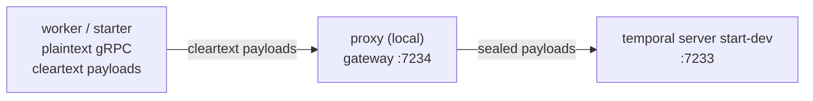

# Nexus example

This example sends Nexus Operations through the proxy with payload encryption on. One Worker serves a Nexus Service
whose Operation runs a handler Workflow, and a starter calls that Operation two ways: from a caller Workflow, and as a
standalone Operation started straight from the client with no Workflow in between. The Worker and starter exchange
cleartext; the dev server only ever stores the Operation's input and result sealed.



## Prerequisites

- Go and a checkout of this repository; the proxy and the example both run from source.
- The `temporal` CLI, 1.9 or later, for the dev server, the Nexus Endpoint, and inspecting results.
- No cloud account and no credentials: everything in this example runs on localhost.

Everything under `examples` is one Go module, and its `go.mod` builds the proxy from this working tree with a `replace`
directive; if you copy this example into another tree, drop that `replace` line and require a released proxy version
instead.

## Run

Open three terminals.

Terminal 1 starts the dev server. Standalone Nexus Operations are off by default, so the three dynamic config values
turn them on:

```bash
temporal server start-dev \
  --dynamic-config-value history.enableChasm=true \
  --dynamic-config-value nexusoperation.enableStandalone=true \
  --dynamic-config-value nexusoperation.enableChasmWorkflowOperations=true
```

Once it is up, create the Nexus Endpoint the starter calls. It routes to the Worker's task queue in the same Namespace:

```bash
temporal operator nexus endpoint create \
  --name hello-endpoint \
  --target-namespace default \
  --target-task-queue nexus-example
```

```text
Endpoint hello-endpoint successfully created.
```

Terminal 2, from the repository root, starts the proxy:

```bash
go run ./cmd/proxy serve -c examples/nexus/config.yaml
```

```text
{"level":"info","namespace":"default","uri":"testing://<redacted>","time":"2026-11-24T12:53:34-05:00","message":"Registering crypto key"}
{"level":"warn","addr":"127.0.0.1:7234","time":"2026-11-24T12:53:34-05:00","message":"Running with insecure credentials. Configure TLS for production use."}
{"level":"info","addr":"127.0.0.1:7234","time":"2026-11-24T12:53:34-05:00","message":"Starting the server"}
```

The `Running with insecure credentials` warning describes the local gateway, the plaintext hop between the
Worker/starter and the proxy on this machine. It says nothing about whether payloads get sealed.

Terminal 3, in `examples/nexus`, starts the Worker:

```bash
go run ./worker
```

```text
2026/11/24 12:32:10 worker listening on task queue "nexus-example"
```

With all three running, run the starter from `examples/nexus`:

```bash
go run ./starter
```

```text
2026/11/24 12:54:47 started workflow id=nexus-example-caller runID=01a20eb2-2c90-79fe-8d9b-ad8a277f6a70
from workflow:   Hello, Temporal!
2026/11/24 12:54:47 started operation id=nexus-example-standalone runID=01a20eb2-2c9c-79b8-a0a6-af3864b4d6ff
standalone:      Hello, Temporal!
```

Pass a name as the first argument to greet someone else. Your run IDs and timestamps will differ.

## What just happened

Both callers reach the same Operation, `say-hello` on `hello-service`, through the Endpoint `hello-endpoint`:

1. **From a Workflow.** `CallerWorkflow` schedules the Operation with `workflow.NewNexusClient`. The Operation's input
   rides in the Workflow's `ScheduleNexusOperation` command, and its result comes back in a `NexusOperationCompleted`
   history event.
2. **Standalone.** The starter calls `client.NewNexusClient(...).ExecuteOperation` directly. The server keeps the
   Operation as its own execution and the starter polls it for the result.

Either way the handler side is identical: the Worker receives a Nexus task, starts `HelloHandlerWorkflow`, and that
Workflow's result completes the Operation. The proxy seals every payload on the way to the dev server and opens it on
the way back, so the Worker and starter never handle ciphertext.

## See the ciphertext

> [!NOTE]
>
> If `TEMPORAL_API_KEY` is set in your shell, or a CLI profile turns on TLS, the commands below fail with a TLS error.
> Everything here is plaintext on localhost; unset it, or add `--tls=false`.

The standalone Operation's result, straight from the dev server, cannot be decoded without the key:

```bash
temporal nexus operation result --operation-id nexus-example-standalone --address 127.0.0.1:7233
```

```text
Results:
Error: nexus operation completed, but failed decoding result: encoding binary/encrypted: payload encoding is not supported
```

Through the proxy, the same result comes back in the clear:

```bash
temporal nexus operation result --operation-id nexus-example-standalone --address 127.0.0.1:7234
```

```text
Results:
  Status  COMPLETED
  Result  "Hello, Temporal!"
```

The caller Workflow's history shows the same split. Straight from the dev server:

```bash
temporal workflow show --workflow-id nexus-example-caller --address 127.0.0.1:7233
```

```text
Progress:
  ID           Time                     Type
    1  2026-11-24T17:54:47Z  WorkflowExecutionStarted
    2  2026-11-24T17:54:47Z  WorkflowTaskScheduled
    3  2026-11-24T17:54:47Z  WorkflowTaskStarted
    4  2026-11-24T17:54:47Z  WorkflowTaskCompleted
    5  2026-11-24T17:54:47Z  NexusOperationScheduled
    6  2026-11-24T17:54:47Z  NexusOperationStarted
    7  2026-11-24T17:54:47Z  WorkflowTaskScheduled
    8  2026-11-24T17:54:47Z  WorkflowTaskStarted
    9  2026-11-24T17:54:47Z  WorkflowTaskCompleted
   10  2026-11-24T17:54:47Z  NexusOperationCompleted
   11  2026-11-24T17:54:47Z  WorkflowTaskScheduled
   12  2026-11-24T17:54:47Z  WorkflowTaskStarted
   13  2026-11-24T17:54:47Z  WorkflowTaskCompleted
   14  2026-11-24T17:54:47Z  WorkflowExecutionCompleted

Results:
  Status          COMPLETED
  Result          {"metadata":{"encoding":"YmluYXJ5L2VuY3J5cHRlZA==","encryption-dek":"ZnRXdTViMkcxQ3pZSUV0bjJLa0gvVVJ6Z245YWxXalI5cDJYU052YkQwSCtxSXVFMlJ4VkVVYlpGRloweFljSDk1dnFOeTlLQWs1M0Fna0ZENGprZkJ4WUhmM3k5QTk2","encryption-key-id":"YmFzZTY0a2V5Oi8vS2lvcUtpb3FLaW9xS2lvcUtpb3FLaW9xS2lvcUtpb3FLaW9xS2lvcUtpbz0=","encryption-namespace":"ZGVmYXVsdA=="},"data":"AzHptVXYgOsqijLAdch+wabA/oLDrVTfJiCpIsly22ZHZoDd1JEfZa/p95L6d11HFbAkZMk6AH6UJ59Usig/ntD3adCRgxiA"}
  ResultEncoding  binary/encrypted
```

Through the proxy (only the `Results` block is shown):

```bash
temporal workflow show --workflow-id nexus-example-caller --address 127.0.0.1:7234
```

```text
Results:
  Status          COMPLETED
  Result          "Hello, Temporal!"
  ResultEncoding  json/plain
```

## What the server can still read

Encryption works on payloads, not on whole records. The server stores a standalone Operation as one execution whose
state mixes its own bookkeeping with your data, and the proxy seals only the payload fields inside it: the Operation's
input and result are ciphertext, while the Endpoint, Service, and Operation names, IDs, timestamps, attempt counts, and
the Operation token stay readable, because the server routes, retries, and times out on them. Search attributes stay
readable for the same reason.

## Running it again

The starter uses the fixed IDs `nexus-example-caller` and `nexus-example-standalone`. Run it again after the previous run
completes and both calls start fresh executions with new run IDs; no cleanup is needed. The dev server keeps everything
in memory, so restarting it clears all state, including the Nexus Endpoint, which you then create again.
